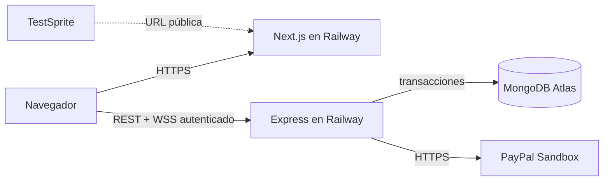

# Arquitectura, datos y API

Se separó Next.js del backend para que el servidor controle autenticación, precios, stock, pagos y estados. WebSocket comparte el proceso de Express. Se eligió `ws` en lugar de Socket.IO para un protocolo mínimo; cada conexión se autentica con un primer mensaje y recibe únicamente sus pedidos o, si es personal, eventos de operación. La interfaz recupera el estado por REST al reconectar.

El backend selecciona MongoDB Atlas con Mongoose si existe `MONGODB_URI`, o `node:sqlite` cuando no está configurada. SQLite usa `BEGIN IMMEDIATE`; Mongoose usa `connection.transaction()` para reservar y liberar stock en la misma transacción que guarda el pedido. La conexión a Atlas y el flujo de registro, pedido, idempotencia, reserva, cancelación, captura PayPal Sandbox y entrega digital se verificaron con el clúster. [Mongoose documenta las transacciones y AsyncLocalStorage](https://mongoosejs.com/docs/transactions.html).

## Modelo de datos

| Entidad | Campos clave | Regla |
|---|---|---|
| `users` | `id`, `name`, `email`, `passwordHash`, `role`, `createdAt` | `role` es `customer` o `staff`; registro público siempre asigna `customer`. |
| `books` | `id`, `title`, `author`, `description`, `category`, `format`, `priceCents`, `stock`, `available`, `digitalContent`/`downloadFile` | Precio y stock no negativos; el contenido digital no sale en el catálogo público. |
| `orders` | `id`, `userId`, `items`, `address`, `shippingCents`, `totalCents`, `status`, `paymentStatus`, `idempotencyKey`, marcas de tiempo | Cada ítem guarda instantánea de precio; stock reservado en la misma transacción. |
| `payments` | `id`, `orderId`, `providerOrderId`, `captureId`, `amountCents`, `currency`, `status` | Un pago por pedido; ID de PayPal único. No se almacenan datos de tarjeta. |

Los importes se expresan en centavos USD para evitar errores de punto flotante. El costo de envío físico es de 500 centavos. La descarga digital se autoriza por propiedad del pedido y captura confirmada; los pedidos solo digitales pasan a `DELIVERED` automáticamente.

## API

| Método y ruta | Acceso | Acción |
|---|---|---|
| `GET /health` | Público | Estado sin secretos. |
| `POST /api/auth/register` | Público | Crea cliente. |
| `POST /api/auth/login` | Público | Devuelve token firmado; límite básico de intentos. |
| `GET /api/auth/me` | Autenticado | Perfil sin hash. |
| `GET /api/books`, `GET /api/books/:id` | Público | Catálogo y detalle. Acepta `category` y `q`. |
| `POST /api/books`, `PATCH /api/books/:id` | Personal | Gestiona libro y stock. |
| `POST /api/orders` | Cliente | Crea pedido; acepta `Idempotency-Key`. |
| `GET /api/orders/me`, `GET /api/orders/:id` | Propietario o personal | Consulta autorizada. |
| `POST /api/orders/:id/cancel` | Propietario | Cancela solo pendiente y libera stock. |
| `GET /api/staff/orders` | Personal | Tablero. |
| `PATCH /api/orders/:id/status` | Personal | Avanza un estado; guía obligatoria al enviar impreso. |
| `POST /api/payments/paypal/order` | Propietario | Crea orden PayPal con total del servidor. |
| `POST /api/payments/paypal/capture` | Propietario | Captura y verifica estado, ID, moneda e importe. |
| `GET /api/orders/:id/download/:bookId` | Propietario con pago capturado | Entrega digital. |
| `GET /ws` | Conexión con origen permitido y primer mensaje `{type:"auth",token}` | Eventos `order:created`, `order:statusChanged`, `order:updated`. |

## Límites de confianza y riesgos conocidos

- El token se guarda en `sessionStorage`; expira a las 24 horas. El sitio debe mantener protección contra XSS y usar HTTPS en producción.
- La limitación de login es en memoria por proceso, suficiente para demostración local; producción requiere un almacén compartido y controles de abuso adicionales.
- La captura usa `PayPal-Request-Id` estable para reducir duplicados. Si PayPal confirma la captura pero falla la escritura local, la opción «Verificar pago» permite conciliar el pedido tras consultar y validar la captura. La recuperación todavía requiere una acción manual; no existe exclusión distribuida entre varias réplicas. Mantener una sola instancia y revisar pagos antes de una liberación real.
- Para pedidos cancelados con una orden PayPal asociada, el historial consulta a PayPal antes de ofrecer «Verificar pago». Si PayPal no responde, el historial sigue disponible pero oculta temporalmente esa opción; una nueva carga puede volver a comprobarla. La consulta añade latencia y necesitaría caché o conciliación programada en un sistema comercial.
- El contenido digital se almacena como texto de hasta 90 KB; un catálogo comercial necesitaría almacenamiento de objetos y enlaces de descarga temporales.
- El stock reservado vence a los 30 minutos mediante tarea del proceso. Si el servidor está detenido, se libera cuando vuelve a iniciar y corre la tarea.
